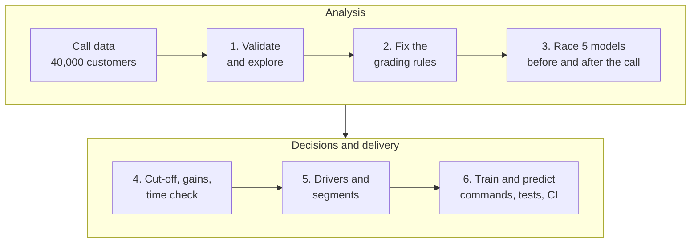
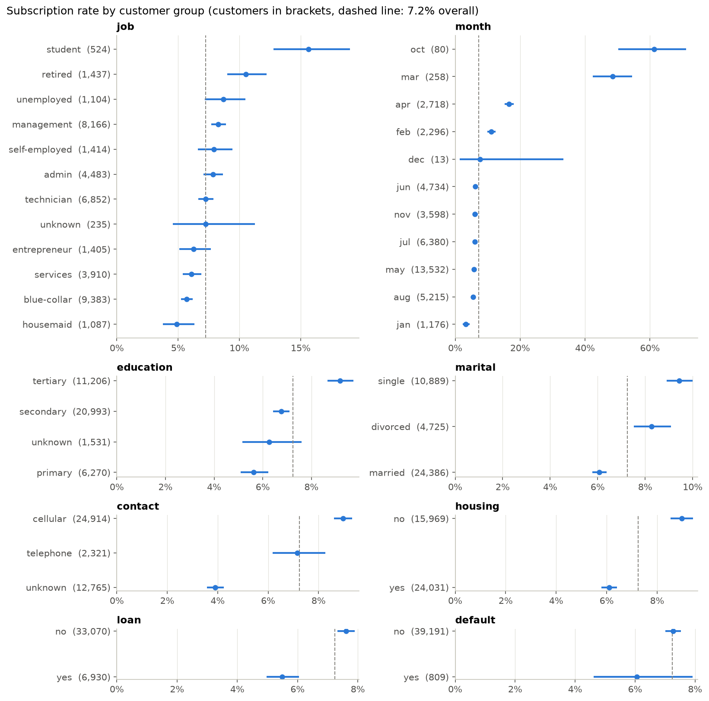
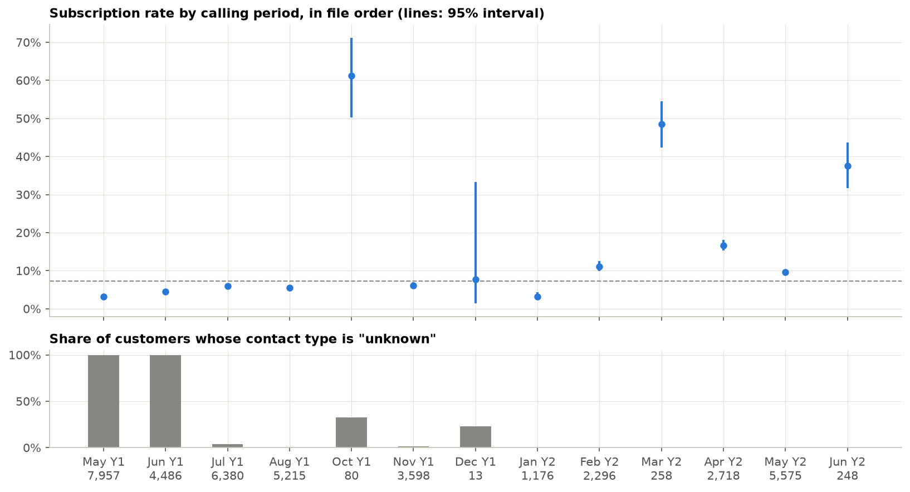
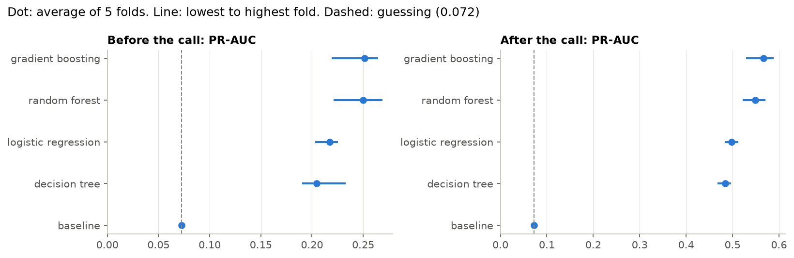
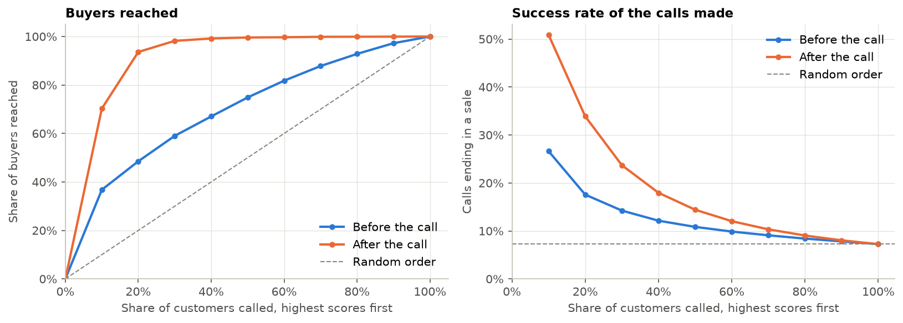
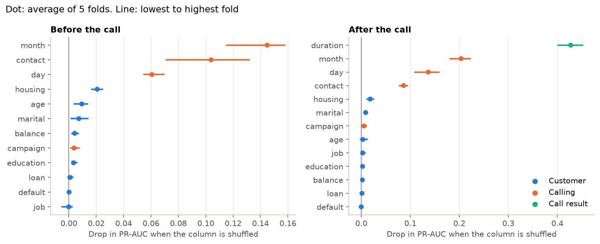
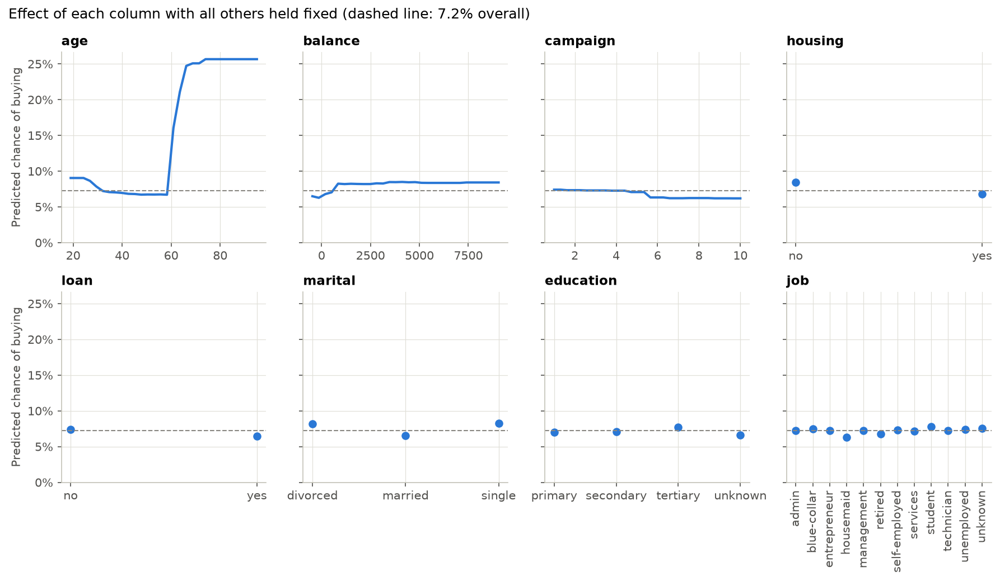
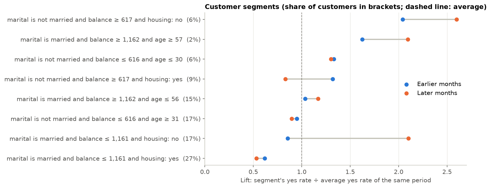

# Predicting Term-Deposit Subscriptions from Call-Center Data

[](https://github.com/layalsaad/LMRdjuHuR6wIj6H7/actions/workflows/ci.yml)


[](https://github.com/astral-sh/uv)
[](https://github.com/astral-sh/ruff)

An end-to-end machine learning project, completed with [Apziva](https://www.apziva.com/), for a
European bank that sells term deposits by phone. It predicts which customers will subscribe,
explains what makes them buy, names the customer segments to call first, and ships the result as
two tested commands the bank can run after every campaign.

The project's defining choice: only 7% of customers buy, so the brief's accuracy target is met by
a model that finds **nobody**. The project measures what the bank actually needs instead (how
many calls succeed, how many buyers are reached) and splits the work into a **before-the-call**
and an **after-the-call** model, because call length is only known once the call has ended.

## At a glance

| Topic                                         | Result                                                                                                                                                              |
| --------------------------------------------- | ------------------------------------------------------------------------------------------------------------------------------------------------------------------- |
| **Brief's target: ≥ 81% accuracy, 5-fold CV** | **Met: 91.1%** before the call, **92.7%** after. But always answering "no" scores 92.8%, so accuracy alone proves nothing here                                      |
| **Calls that end in a sale**                  | **36.6%** before the call (vs 7.2% when calling at random), **49.9%** after the call                                                                                |
| **Calling the top 10% of the ranked list**    | Reaches **37%** of all buyers at **3.7×** the random success rate; about **2×** on later months the model never saw                                                 |
| **What makes customers buy**                  | **When and how** the bank calls (campaign period, mobile contact), **engagement** during the call, then **age 60+**, **no housing loan**, **balance above ~€1,000** |
| **Segments to call first**                    | Not married, balance ≥ €617, no housing loan (**2.0–2.6×** the average rate), then married customers aged 57+ with balance ≥ €1,162 (**1.6–2.1×**)                  |
| **Engineering**                               | Python package, `train` / `predict` commands with input checks, 51 tests, CI, fully reproducible                                                                    |

## Contents

1. [Business problem](#business-problem)
2. [Data](#data)
3. [Project workflow](#project-workflow)
4. [Design reasoning](#design-reasoning)
5. [Step-by-step walkthrough](#step-by-step-walkthrough)
6. [Business recommendations](#business-recommendations)
7. [Key decisions and trade-offs](#key-decisions-and-trade-offs)
8. [Repository structure](#repository-structure)
9. [Getting started](#getting-started)
10. [Tech stack](#tech-stack)
11. [Limitations and next steps](#limitations-and-next-steps)
12. [Concluding remarks for hiring managers and recruiters](#concluding-remarks-for-hiring-managers-and-recruiters)

## Business problem

A bank phones its customers to offer a **term deposit**: the customer locks money away for a
fixed time (from a month to a few years) and earns interest in return. Most customers say no,
and every call costs an agent's time and can annoy the customer.

The client wants a machine learning product that raises the success rate of these calls and
stays interpretable, so the bank can make informed decisions.

- **Goal:** predict whether a customer will subscribe (`y`), with at least **81% accuracy**
  measured as the average of 5-fold cross-validation.
- **Challenges:** find the customer **segments** the bank should prioritise, and the **features**
  that make customers buy.

## Data

40,000 customers from direct-marketing campaigns; **2,896 (7.2%) subscribed**. Personal
information has been removed. The data belongs to the client and is not included in this
repository.

| Column      | Meaning                    | Column         | Meaning                                      |
| ----------- | -------------------------- | -------------- | -------------------------------------------- |
| `age`       | Age                        | `loan`         | Has a personal loan?                         |
| `job`       | Type of job                | `contact`      | Contact type (cellular, telephone, unknown)  |
| `marital`   | Marital status             | `day`, `month` | Day and month of the last contact            |
| `education` | Education level            | `duration`     | Length of the last call, in seconds          |
| `default`   | Has credit in default?     | `campaign`     | Calls made to this customer in this campaign |
| `balance`   | Average yearly balance (€) | **`y`**        | **Target: subscribed to a term deposit?**    |
| `housing`   | Has a housing loan?        |                |                                              |

## Project workflow



Each step answered one question, and its answer decided what the next step looked at.

## Design reasoning

### Why two models: before the call and after it

A prediction is only useful if every input is known **when the decision is made**. The bank
decides twice: **before dialling** (whom to call, in what order) and **after a conversation**
(whom to call back). Call length (`duration`) is the strongest signal in the data, but it only
exists after hanging up. A single model using it would look excellent and could never choose
whom to call: that is **data leakage**. Dropping `duration` everywhere would waste it for
callbacks. So there is **one model per decision**, each using exactly what is known at that moment.

Two cautions: long calls don't _cause_ sales (interested customers talk longer), and `duration`
is the length of the **last** call, often the one where the customer said yes, so the
after-the-call scores are a best case.

### Why these five models

The data has 40,000 rows, mixed numbers and categories, only 7% positives, and a client who wants
explanations and trustworthy probabilities. The models form a ladder from simple to flexible:

| Model                  | What it adds                             | Why it is in the race                       |
| ---------------------- | ---------------------------------------- | ------------------------------------------- |
| Baseline (always "no") | Nothing                                  | The yardstick every model must beat         |
| Logistic regression    | A weight per feature                     | Fast, explainable, honest probabilities     |
| Decision tree          | If-then rules and interactions           | Rules a person can read                     |
| Random forest          | Hundreds of trees voting                 | Steadier than one tree, little tuning       |
| Gradient boosting      | Trees that correct each other's mistakes | Usually the strongest on tabular data, fast |

Not tested: k-nearest neighbours and SVMs (slow on 40,000 rows, hard to explain), neural networks
(no advantage on a small table, hardest to explain), XGBoost/LightGBM/CatBoost (the same idea as
gradient boosting, an extra dependency for little gain), Naive Bayes (assumes independent
features; age and job are not).

### Which metric for which use

| Use                                     | Question                                | Metric                                           |
| --------------------------------------- | --------------------------------------- | ------------------------------------------------ |
| Compare models fairly                   | Who ranks buyers above non-buyers best? | **PR-AUC** (main), ROC-AUC                       |
| Fixed call capacity                     | What do the top N calls achieve?        | **Gains, success rate, lift**                    |
| Calls are costly or annoy customers     | Of the calls made, how many succeed?    | **Precision**                                    |
| Every sale is valuable, calls are cheap | Of all buyers, how many are reached?    | **Recall**                                       |
| Costs not known yet                     | A fair balance of both                  | **F1** (used to set the cut-off)                 |
| Forecast a campaign's sales             | Are the probabilities right?            | **Calibration**                                  |
| The next campaign                       | Does it hold on later months?           | **Time-ordered check**                           |
| The brief                               | Share of right answers                  | Accuracy: reported, but always "no" scores 92.8% |

### Where the predictions are used

- **Before the call:** the daily call list (agents start at the top), campaign sizing (the sum of
  the probabilities is the expected number of sales), channel choice (call the high scores, send a
  letter or e-mail to the low ones), matching the best agents to the best leads, and limiting
  repeat calls.
- **After the call:** a callback queue, and warm leads handed to a senior adviser.
- **From the insights:** which customer groups to target and what offers to design for them.
- **Over time:** compare predicted with actual sales after each campaign, and retrain.

## Step-by-step walkthrough

### 1. Validate and explore the data

📓 [`notebooks/01_eda.ipynb`](notebooks/01_eda.ipynb)

Every file is checked on load: required columns, no empty cells, whole numbers in valid ranges,
`yes`/`no` only in yes/no columns, with one error message listing every problem. The data was
clean: no missing values, no duplicates.



- **Baseline to beat:** always answering "no" is **92.8%** accurate. Accuracy cannot judge models
  here.
- **Who says yes more often** (rates with 95% intervals, so small groups can't mislead):
  customers aged 25 or under (13.6%) and over 60 (38.9%, a small group of 234), students (15.6%)
  and retirees (10.5%), customers without a housing loan (9.0% vs 6.1%), higher balances, and the
  first call of a campaign (8.6%, down to 3.7% after more than 10 calls).
- **Call length separates yes from no:** buyers' calls last 629 s at the median, others 164 s.
  Under a minute, almost nobody buys (0.1%); over 20 minutes, 61.8% do.



- **The rows are in date order, and the yes rate changes over time.** The same month name has very
  different rates (May of the first year: 3.2%, May of the second: 9.6%), and `contact = unknown`
  only exists in the first two months. So `month` and `contact` partly record **when** a customer
  was called, which led to the time-ordered check in step 5.

### 2. Fix the grading rules before building any model

All rules live in [`evaluation.py`](src/term_deposit/evaluation.py) and were tested on two useless
models first: "always no" (92.8% accurate) and "guess yes 7% of the time" (86.6% accurate)
**both pass the brief's 81% target**, while their PR-AUC stays at the 0.072 floor.

- **Stratified 5-fold cross-validation** (the brief's 5 folds; each fold keeps the 7.2% share of
  buyers), with **nested tuning**: settings are chosen inside each training fold, never on the
  test fold.
- **PR-AUC** as the main metric (it rewards putting buyers at the top of the call list), plus
  ROC-AUC, precision, recall, F1 and the brief's accuracy.
- The **corrected resampled t-test** (Nadeau & Bengio) to tell real differences from luck.
- **Gains tables** from out-of-fold scores, and a **time-ordered split** (train on the first 80% of
  rows, test on the last 20%).

### 3. Race five models, before and after the call

📓 [`notebooks/02_modeling.ipynb`](notebooks/02_modeling.ipynb)



| Model                  | PR-AUC before the call | PR-AUC after the call |
| ---------------------- | ---------------------- | --------------------- |
| **Gradient boosting**  | **0.251**              | **0.567**             |
| Random forest          | 0.250 (tie, p = 0.84)  | 0.549 (tie, p = 0.18) |
| Logistic regression    | 0.217 (p = 0.008)      | 0.498 (p = 0.015)     |
| Decision tree          | 0.205 (p = 0.021)      | 0.484 (p = 0.001)     |
| Baseline (always "no") | 0.072                  | 0.072                 |

**Gradient boosting** was chosen for both: it ties with random forest but trains 3–5× faster
(it is retrained every campaign), and it is significantly better than the simpler models, so
choosing those for readability would cost real buyers. The chosen model is explained with
importance and partial-dependence charts instead (step 6).

### 4. Choose the cut-off, and meet the brief's target honestly

At the default cut-off of 0.5 the before-the-call model says "yes" to almost nobody (recall 3.6%),
because hardly any customer reaches a 50% chance when only 7% buy. Each model therefore **learns
its cut-off** (best F1) inside its training folds: about 0.16 before the call and 0.29 after.

| Learned cut-off, 5-fold CV          | Before the call               | After the call                |
| ----------------------------------- | ----------------------------- | ----------------------------- |
| **Accuracy (target ≥ 81%)**         | **91.1%** (lowest fold 90.5%) | **92.7%** (lowest fold 92.2%) |
| Precision: calls that end in a sale | 36.6%                         | 49.9%                         |
| Recall: buyers found                | 29.5%                         | 72.9%                         |

> [!IMPORTANT]
> The target is met in every fold, but "always no" also meets it. Precision and recall are the
> evidence that the models are useful.

### 5. Gains, calibration and the time check



- **Before the call:** the top 10% of the list holds **37%** of all buyers at a **26.6%** success
  rate (**3.7×** random). The top 20% holds 49%; half the list holds 75%.
- **After the call:** the top 10% holds **70%** of buyers at **51%** success (7×); the top 20%
  holds 94%.
- **Calibration:** the probabilities can be summed into a sales forecast. Before the call the model
  expects **2,899** buyers, and there were **2,896**; after the call, 2,884.
- **Time check** (train on earlier months, test on later ones, where 12.5% buy): before the call
  the top 10% still buys at **26%**, a **2.1×** lift (ROC-AUC 0.64 vs 0.72 in shuffled folds);
  after the call 54%, 4.3×. Dropping `month` and `day` made later months _worse_ (PR-AUC 0.218 →
  0.195), so they stay.

> [!NOTE]
> Expect the **time-check** numbers on a new campaign: about **2× more sales per call** from the
> top tenth of the list. Retraining on each campaign's results keeps the model current.

### 6. What makes customers buy

📓 [`notebooks/03_drivers_and_segments.ipynb`](notebooks/03_drivers_and_segments.ipynb)

**Permutation importance** (how much worse the model ranks buyers when one column is shuffled,
measured on unseen folds):



- **Before the call, timing leads:** `month` (0.145), `contact` (0.104), `day` (0.061). Together
  they mark which campaign days went well. Customer traits follow: housing loan (0.021), age,
  marital status, balance.
- **After the call, engagement dominates:** `duration` (0.427).
- **Customer traits alone** rank buyers about **2× better than guessing** (PR-AUC 0.138 vs 0.072),
  led by age, housing loan and balance.

**Partial dependence** (the direction of each effect, with everything else held fixed):



- **Age:** about 7% from 30 to 60, 9% under 25, and **over 20% from about 65** (only 234 customers
  are over 60, so the size is uncertain; the direction is not).
- **Balance:** 6% at zero, 8% from about €1,000, then flat. **No housing loan:** 8.4% vs 6.8%.
  **Single or divorced:** 8.2% vs 6.6% married.
- **Job is flat once age is known:** students and retirees buy more because of their age.
- **Calls:** flat for the first 5, then lower.

### 7. Which segments to prioritise

A shallow decision tree on **customer traits only** (so segments describe people and hold in the
next campaign), at most 3 questions deep, each segment at least 2% of customers. It was learned
on the earlier 80% of rows and checked on the later 20%, comparing **lift** (segment rate ÷ the
period's average, since the average rose from 5.9% to 12.5%).



| Priority | Segment                                        | Customers | Lift: earlier → later |
| -------- | ---------------------------------------------- | --------- | --------------------- |
| **1**    | Not married, balance ≥ €617, no housing loan   | 6%        | **2.0× → 2.6×**       |
| **2**    | Married, aged 57+, balance ≥ €1,162            | 2%        | **1.6× → 2.1×**       |
| **3**    | Not married, aged 30 or under, balance ≤ €616  | 6%        | 1.3× → 1.3×           |
| Last     | Married, balance ≤ €1,161, with a housing loan | 27%       | 0.6× → 0.5×           |

Two of the eight segments flipped between the periods and are not recommended.

### 8. Ship it: `train` and `predict` commands

```bash
uv run term-deposit-train
# pre_call: trained on 40000 customers. 5-fold accuracy 91.1%, precision 36.6%, recall 29.5%, PR-AUC 0.251. Cut-off 0.16. ...
# post_call: trained on 40000 customers. 5-fold accuracy 92.7%, precision 49.9%, recall 72.9%, PR-AUC 0.567. Cut-off 0.29. ...

uv run term-deposit-predict new_customers.csv --output call_list.csv
# Wrote N predictions to call_list.csv (M marked to call)
```

- **Before-the-call lists need no `duration` and no `y`:** each model asks only for the columns it
  was trained on. Extra columns such as customer IDs are kept.
- **Useful output:** `probability_subscribe` (calibrated), `prediction` (1 = call, at the learned
  cut-off) and `priority_rank` (1 = call first).
- **Safe input:** a bad file stops with a one-line error and exit code 1; a job title never seen in
  training is scored and reported as a warning.
- **Traceable models:** each `models/<stage>.joblib` comes with a JSON file recording the settings,
  cut-off, cross-validated scores, known categories, library versions and a fingerprint of the
  training data.

### 9. Engineering quality

- **51 tests** on synthetic data with a built-in pattern, covering validation, every model, the
  grading rules, importance, segments and both commands. They run without the private data.
- **Continuous integration:** GitHub Actions installs the locked environment and runs Ruff, the
  format check and the tests on every push.
- **Reproducible:** fixed seeds and a lockfile; re-running the notebooks gives identical numbers.

## Business recommendations

1. **Order every campaign's call list by the model's score.** In cross-validation the top tenth of
   the list held 37% of all buyers; on later months it held about 21%, at 2.1× the average success
   rate. That is the realistic expectation for a new campaign.
2. **Prioritise the segments that held up in both periods:** single or divorced customers with
   savings and no housing loan, married customers aged 57+ with savings, and young single customers.
   Customers over 60 belong near the top wherever they appear.
3. **Move the largest low segment to a cheaper channel:** married customers with a low balance and
   a housing loan (27% of customers) buy at half the average rate.
4. **Cap repeat calls at about 5 per customer per campaign;** the chance drops after that.
5. **Use the after-the-call model for callbacks:** its top tenth holds 70% of the buyers.
6. **Retrain after every campaign** with `term-deposit-train`, and compare predicted with actual
   sales: success depends strongly on _when_ a campaign runs, and that changes from year to year.

## Key decisions and trade-offs

| Decision             | Chosen                                                   | Instead of                      | Why                                                  |
| -------------------- | -------------------------------------------------------- | ------------------------------- | ---------------------------------------------------- |
| Use of `duration`    | Two models, before and after the call                    | One model with all columns      | `duration` only exists after the call (data leakage) |
| Main metric          | PR-AUC, with precision, recall and gains                 | Accuracy                        | Always "no" is 92.8% accurate                        |
| Evaluation           | Stratified 5-fold, nested tuning, corrected t-test       | One split, tuning on test folds | Honest, comparable scores                            |
| Model                | Gradient boosting                                        | Random forest                   | Tied; 3–5× faster to retrain                         |
| Model                | Gradient boosting                                        | Logistic regression, one tree   | Significantly better (p ≤ 0.02)                      |
| Cut-off              | Learned per model (best F1)                              | 0.5                             | 0.5 finds 3.6% of buyers before the call             |
| Class imbalance      | Ranking metric and learned cut-off                       | Class weights                   | Keeps probabilities calibrated for forecasting       |
| Calendar columns     | Kept                                                     | Dropped                         | Dropping them was worse on later months              |
| Segments             | Shallow tree on customer traits, checked on later months | Clustering                      | Groups are built around buying, and proven to hold   |
| Reported performance | 5-fold plus the time check                               | 5-fold only                     | New campaigns look like the time check               |
| Scope                | scikit-learn, CLI, tests, CI                             | Docker, MLflow, a web API       | Proportionate to the client's needs today            |

## Repository structure

```
.github/workflows/ci.yml   # CI: lint, format check and tests on every push
notebooks/                 # run in order: 01 EDA → 02 modeling → 03 drivers and segments
reports/figures/           # charts saved by the notebooks
src/term_deposit/
├── config.py              # columns, stages, paths, seeds, chosen models
├── data.py                # loading and validation
├── evaluation.py          # metrics, cross-validation, t-test, gains, time split
├── models.py              # candidate models, data preparation, learned cut-off
├── insights.py            # rates with intervals, permutation importance, segments
├── train.py               # term-deposit-train command
└── predict.py             # term-deposit-predict command
tests/                     # 51 tests on synthetic data
pyproject.toml, uv.lock    # dependencies, pinned for reproducibility
```

## Getting started

Requires [uv](https://docs.astral.sh/uv/), which also installs the right Python version.

```bash
git clone https://github.com/layalsaad/LMRdjuHuR6wIj6H7.git
cd LMRdjuHuR6wIj6H7
uv sync                       # Python 3.12 + locked dependencies
# place term-deposit-marketing-2020.csv in data/raw/
```

| Task                          | Command                                                                          |
| ----------------------------- | -------------------------------------------------------------------------------- |
| Run the tests                 | `uv run pytest`                                                                  |
| Lint and format               | `uv run ruff check .` · `uv run ruff format .`                                   |
| Explore the analysis          | `uv run jupyter lab` (01: under a minute, 02: about 6–8 min, 03: about 2 min)    |
| Train both models             | `uv run term-deposit-train`                                                      |
| Rank customers before calling | `uv run term-deposit-predict customers.csv --output call_list.csv`               |
| Rank callbacks after calling  | `uv run term-deposit-predict calls.csv --stage post_call --output callbacks.csv` |

The tests use synthetic data, so they run without the dataset. Only load model files you trained
yourself: joblib files can run code when loaded.

## Tech stack

| Area          | Tools                                                       |
| ------------- | ----------------------------------------------------------- |
| Language      | Python 3.12                                                 |
| Data and ML   | pandas, NumPy, scikit-learn, SciPy                          |
| Visualization | Matplotlib, Jupyter                                         |
| Engineering   | uv (environment and lockfile), Ruff, pytest, GitHub Actions |

## Limitations and next steps

- **Performance drifts over time:** the yes rate is 5.9% in the first 80% of the rows and 12.5% in
  the last 20%, and the before-the-call model's lift falls from 3.7× to about 2× on later months.
  Retrain every campaign and track predicted vs actual sales.
- **Calendar effects are not seasons:** `month` and `day` describe past campaign periods. They help
  rank customers within a campaign but should not be read as "always call in March".
- **The after-the-call scores are a best case,** because `duration` is the length of the last call,
  which is often the call that closed the sale.
- **Associations, not causes:** the drivers show who is more likely to buy, not what would change a
  customer's decision. An A/B test is needed for that.
- **Next:** set the cut-off from real costs (the cost of a call, the value of a sale) instead of F1,
  add data about previous campaigns and customer contact history, and monitor input drift with
  the warnings the predict command already gives.

## Concluding remarks for hiring managers and recruiters

I completed this project at Apziva, end to end: from reading the brief and exploring the data to a
tested product the client can run every campaign. The brief asked for 81% accuracy; the most
valuable thing I delivered was showing why that target alone would mislead the bank, and building
what the bank actually needs instead.

### My contribution

| Area                       | What I did                                                                                                                                               | Why it matters                                                                             |
| -------------------------- | -------------------------------------------------------------------------------------------------------------------------------------------------------- | ------------------------------------------------------------------------------------------ |
| **Problem framing**        | Noticed that the strongest feature, call length, only exists after the call, and split the work into a before-the-call and an after-the-call model       | Avoided a model that looks excellent on paper but cannot choose whom to call               |
| **Honest evaluation**      | Showed that always answering "no" already scores 92.8%, and judged models on PR-AUC, precision, recall, gains, calibration and a time-ordered check      | The client gets numbers to plan with, including the lower ones to expect on a new campaign |
| **Model selection**        | Compared five models with nested cross-validation and a corrected significance test; chose gradient boosting on evidence, not on one lucky score         | Every choice can be defended, and the simpler models' cost is measured                     |
| **Interpretability**       | Explained the chosen model with permutation importance and partial dependence, and turned customer traits into readable segments checked on later months | The bank sees _why_ customers buy and _whom_ to call first                                 |
| **Business translation**   | Turned results into a ranked call list, a sales forecast, prioritised segments, a channel recommendation and a call cap                                  | Analysis became actions a call center can take                                             |
| **Production engineering** | Built a Python package with `train` and `predict` commands, input validation, model metadata, 51 tests, CI and reproducible results                      | The model can be retrained and used without opening a notebook                             |

### How I work

- **I start from the decision, not the dataset.** Asking _when_ each prediction is used led to the
  two-model design and kept leakage out.
- **I measure what matters and say what I find,** even when it is less flattering: the
  before-the-call lift falls from 3.7× to about 2× on later months, and the README says so.
- **I keep solutions as simple as the evidence allows** and deliver them in a form people can use.

| Skill                             | Where to see it                                                                                                             |
| --------------------------------- | --------------------------------------------------------------------------------------------------------------------------- |
| Exploratory data analysis         | [`01_eda.ipynb`](notebooks/01_eda.ipynb)                                                                                    |
| Model selection and evaluation    | [`02_modeling.ipynb`](notebooks/02_modeling.ipynb), [`evaluation.py`](src/term_deposit/evaluation.py)                       |
| Interpretability and segmentation | [`03_drivers_and_segments.ipynb`](notebooks/03_drivers_and_segments.ipynb), [`insights.py`](src/term_deposit/insights.py)   |
| Production ML code                | [`train.py`](src/term_deposit/train.py), [`predict.py`](src/term_deposit/predict.py), [`data.py`](src/term_deposit/data.py) |
| Testing and CI                    | [`tests/`](tests), [`ci.yml`](.github/workflows/ci.yml)                                                                     |

I'm happy to walk through any part of this project in more detail. Find me on GitHub at
[@layalsaad](https://github.com/layalsaad).
